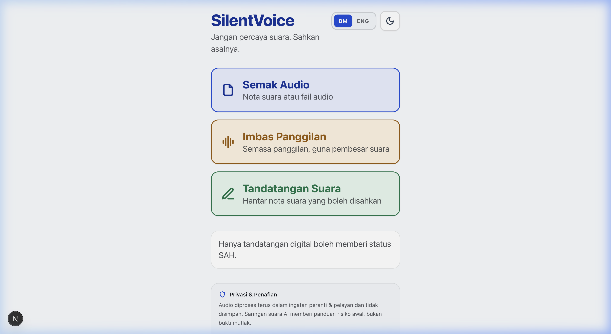
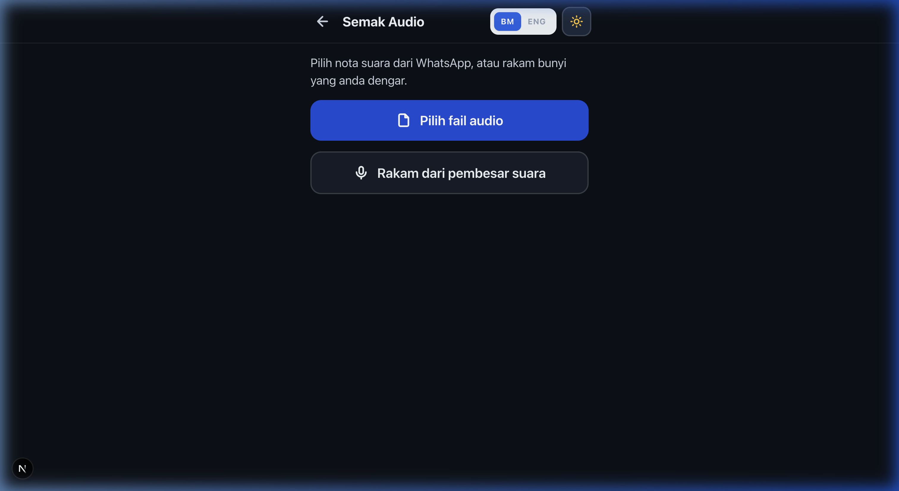
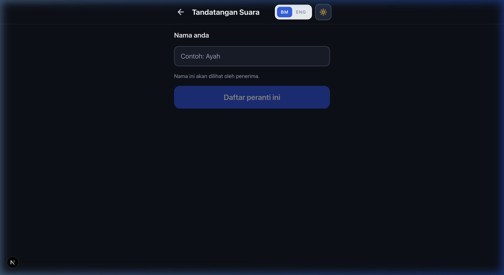
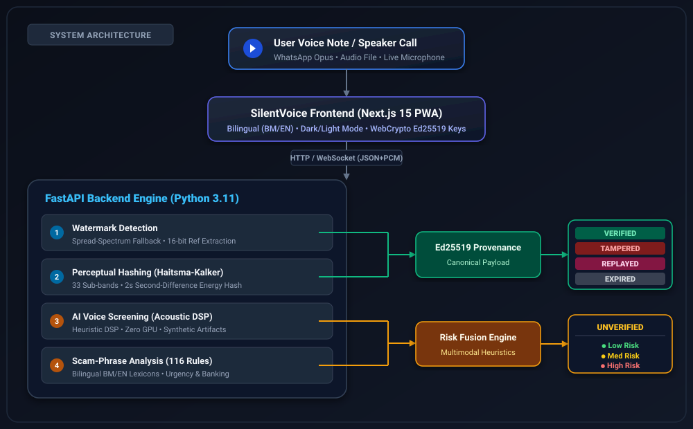

# 🛡️ SilentVoice

<p align="center">
  <strong>Jangan percaya suara. Sahkan asalnya.</strong><br>
  <em>Don't trust the voice. Verify its origin.</em>
</p>

<p align="center">
  
  
  
  
  
</p>

A bilingual (BM/English) mobile web app that tells an ordinary Malaysian whether a voice they are hearing can be trusted — in seconds, with zero technical knowledge.

---

## 📸 App Preview

<p align="center">
  
  
</p>

<p align="center">
  
  
</p>

---

## 💡 Two Ideas, Kept Strictly Separate

SilentVoice enforces an uncompromising security boundary directly in code (`api/app/service.py`):

| | What it does | What it can return |
| :--- | :--- | :--- |
| **Verify what is real** | Cryptographic voice provenance: an Ed25519 signature over perceptual fingerprints of the audio | `VERIFIED` · `TAMPERED` · `REPLAYED` · `EXPIRED` |
| **Warn about what looks fake** | AI-voice screening + BM/EN scam-phrase rules | Risk level only (`LOW`, `MEDIUM`, `HIGH`) — **never** `VERIFIED` |

> ⚠️ **Core Security Law:** *Only cryptographic verification can return `VERIFIED`.* Detection can raise a warning; it can **never** grant trust. Heuristic AI detection is mathematically incapable of issuing `VERIFIED` status in SilentVoice.

---

## 📱 The Three User Flows

Every task is at most three taps from the home screen:

1. **Semak Audio (Verify, no login):** Pick a WhatsApp voice note or record audio you are hearing. Receive a single actionable card: a verdict word, a colour, an icon, and 2–3 concrete next steps.
2. **Imbas Panggilan (Live Scan):** Put the phone call on speakerphone and hold the device close. Initial verdict arrives within seconds and updates every ~2 s. The card turns red only after two consecutive high-risk windows, triggering phone vibration.
3. **Tandatangan Suara (Sign my voice):** Register your device once with an in-browser key. Record up to 60 s and receive a signed WAV to send on WhatsApp. The private key never leaves the device.

---

## 🏛️ System Architecture



```text
  [User Voice Note / Speaker Call]
                 │
                 ▼
  [SilentVoice Frontend (Next.js 15 PWA)]
                 │
                 ▼  (HTTP / WebSocket)
  [FastAPI Backend Engine]
   ├── 1. Watermark Detection ──┐
   ├── 2. Perceptual Hashing  ──┼──> [Ed25519 Provenance] ──> [VERIFIED / TAMPERED / REPLAYED / EXPIRED]
   ├── 3. AI Voice Screening  ──┤
   └── 4. Scam Phrase Rules   ──┴──> [Risk Fusion Engine] ──> [UNVERIFIED (Low / Med / High Risk)]
```

---

## 🔐 How the Security Actually Works

The watermark carries **only a pointer (`ref`)**. Trust comes from a cryptographic signature over the audio's *content fingerprints*, evaluated segment by segment. A watermark alone never makes audio `VERIFIED`.

### 1. Client-Side Cryptographic Signing
1. **Non-Extractable Keys:** The browser generates an **Ed25519** key pair using WebCrypto with `extractable: false` — page scripts can ask the browser to sign, but cannot extract the private key. (`@noble/ed25519` serves as the documented fallback).
2. **Session Issuance:** The server issues a session containing `session_id`, 128-bit `nonce`, `issued_at`, and `expires_at`.
3. **Watermark Embedding First:** Audio is resampled to 16 kHz mono. The 16-bit `wm_ref` is **embedded first**, and only then is the audio divided into 2 s segments and fingerprinted. Fingerprinting the *watermarked* audio guarantees that the signed fingerprints describe the exact bytes the recipient receives.
4. **Domain-Separated Canonical Payload:** The device signs:
   ```text
   DOMAIN ‖ session_id ‖ nonce ‖ issued_at ‖ expires_at ‖ context ‖ SHA-256(fingerprints)
   ```
   Each field is length-prefixed so distinct field sets can never collide.
5. **Zero-Audio Retention:** The server verifies the signature **before** persisting any metadata, returns the signed WAV, and immediately drops the audio buffer from RAM. No database table holds audio.
6. **Client Payload Validation:** The client **reconstructs the exact canonical bytes itself** (`web/src/lib/device-key.ts`) and refuses to sign if they differ from what the server prepared. A compromised backend cannot trick a device into signing a payload for audio it did not record.

### 2. Perceptual Hashing vs. Plain SHA-256
WhatsApp re-encodes every voice note to Opus, meaning a plain SHA-256 hash marks every legitimately forwarded voice note as `TAMPERED`. 

SilentVoice uses a **Haitsma–Kalker style perceptual hash**:
- Computes energies across 33 log-spaced sub-bands between 300 Hz and 3400 Hz.
- Takes the sign of the **second difference** of band energy (difference across adjacent bands, then difference across successive 2-second time windows).
- The double difference cancels out constant gain variations (±6 dB) and slow channel coloration, surviving lossy compression, resampling, and WhatsApp re-encoding — while altering dramatically if phonemes or words are replaced.
- Verification uses bit error rate (BER) matching (< 0.28) with a local alignment search.

### 3. Verdict Decision Rules (First Match Wins)

| Verdict | Trigger Condition |
| :--- | :--- |
| `TAMPERED` | Known `ref`, but signature is invalid, or any 2 s segment fails its fingerprint match, or lacks watermark, or device key is revoked. |
| `REPLAYED` | A signed clip is detected being played into Live Scan audio, or reused past `expires_at`. |
| `EXPIRED` | Valid signature, all segments match, but current timestamp exceeds `expires_at`. |
| `VERIFIED` | Valid signature, all segments match, not expired, device key active. |
| `UNVERIFIED` | No watermark detected — evaluates acoustic AI risk and scam phrase rules. |

> **Architectural Refinement on Unknown Refs:** A watermark whose 16-bit `ref` matches *no database record* is not an invalid signature — it indicates an unissued mark or detector false positive. Marking that as `TAMPERED` would falsely alarm users about an innocent audio clip. An unknown ref falls through to `UNVERIFIED` with a note (`api/app/core/verdict.py`).

Expiry and context are bound *inside* the signature payload, preventing database manipulation from reviving an expired clip.

---

## ⚙️ Pluggable Engine Architecture

Every engine sits behind a modular adapter in `api/app/engines/`. The application runs out of the box with zero GPU requirements and no large model downloads. High-tier neural models can be enabled with a single command:

```bash
cd api && pip install -r requirements.txt -r requirements-ml.txt
```

| Engine Role | Default Fallback (Active) | Production Neural Model (`requirements-ml.txt`) |
| :--- | :--- | :--- |
| **Watermark** | `spread-spectrum-fallback-v1` (differential sub-band patchwork) | **AudioSeal** 16-bit |
| **AI Voice Detection** | `heuristic-dsp-v0` (acoustic screening, uncalibrated) | **XLS-R + AASIST** (`eliya/forensics_0.3B_xlsr_wild_deepfake_classifier`) |
| **Transcription** | Web Speech API (device-side) | **faster-whisper** (BM/EN auto-detect) |

`/health` dynamically reports active engines and calibration flags.

### Soft-Matched Fallback Watermark
Standard hard per-bit decoding with a CRC fails under Opus compression because lossy codecs invert bits sitting directly under dominant vocal harmonics, destroying CRC validity even when sub-band pattern correlation remains at **+0.99**. 

The SilentVoice fallback detector produces soft-decision correlation statistics and matches them against the pool of issued reference IDs, weighting each bit by its confidence score (issued refs correlate > 0.80; random unwatermarked audio peaks below 0.60).

---

## 📐 Key Architectural Decisions

- **Raw PCM via AudioWorklet (No FFmpeg Needed):** Android Chrome's `MediaRecorder` outputs WebM/Opus, which `libsndfile` cannot decode without system `ffmpeg`. SilentVoice captures 32-bit float PCM via an `AudioWorklet` and constructs standard PCM WAV containers on the client, eliminating server-side transcoding bottlenecks.
- **Client-Side Speech Recognition Fallback:** When running on servers without GPU acceleration, the browser's native Web Speech API provides real-time transcripts to feed the 116 BM/EN scam-phrase regex rules.
- **Key-Driven Translations:** The API outputs structured keys (`headline_key`, `step_keys`, `risk.reason`), never hardcoded sentences. Keys map deterministically to BM and English dictionaries in `web/src/lib/strings.ts`.
- **Accessibility Embedded in Design Tokens:** Baseline font is 18 px for elderly readability, interactive tap targets are ≥ 3.5 rem (56 px), layouts adapt down to 360 px, and every verdict couples colour + shape icon + textual label.
- **Client-Side Trusted Sender List:** A digital signature proves a clip came unchanged from a registered public key, not that the display name is verified. First-time senders trigger a yellow warning until the recipient saves them as a trusted contact in device storage.

---

## 📊 Measured Benchmark Behaviour

Evaluated against simulated channel conditions using the automated evaluation harness (`eval/run_eval.py` driving real HTTP endpoints):

| Benchmark Metric | Target | Measured Result |
| :--- | :---: | :---: |
| Signed clip **VERIFIED** after WhatsApp / Opus re-encode | ≥ 95% | **100%** |
| Unsigned audio wrongly shown as **VERIFIED** | 0.0% | **0.0%** |
| Spliced clips caught as **TAMPERED** | ≥ 90% | **100%** |
| Replayed signed clips detected in Live Scan | ≥ 90% | **100%** |
| Scam-phrase recall across BM / EN scripts | ≥ 80% | **100%** |
| Everyday conversational false alarms | 0 | **0** |
| Audio verification latency (median / p95) | ≤ 5 s | **99 ms / 171 ms** |

*Verified under 7 degradation environments: clean 16 kHz, Opus 24 kbps, MP3 128 kbps, GSM 8 kHz telephony, ±6 dB gain, and -40 dB additive acoustic noise.*

---

## 📁 Repository Layout & REST API

```
api/                     FastAPI backend
  app/core/              audio_io, fingerprint, watermark, crypto, verdict, phrases, risk, guidance
  app/engines/           Pluggable engine adapters + runtime registry
  app/routes/            /keys, /sessions, /verify, /live, /reports
  tests/                 Automated pipeline and codec test suite
web/                     Next.js 15 PWA (App Router, Tailwind CSS, TypeScript)
  src/lib/               api, device-key (Ed25519), audio, live (WS), speech, i18n, theme
  src/components/        VerdictCard, AppShell, HeaderControls, Sheets, Feedback, Icons
  public/                manifest, service worker, pcm-worklet.js
eval/                    run_eval.py (PRD §11 harness), make_testset.py (synthetic test sets)
scripts/                 make-dev-cert.sh (Local TLS certificates for mobile testing)
assets/                  Screenshots and documentation assets
```

### API Endpoints

| Method | Endpoint | Description |
| :--- | :--- | :--- |
| `POST` | `/keys` | Register an Ed25519 device public key |
| `POST` | `/keys/{id}/revoke` | Revoke a compromised or lost device key |
| `POST` | `/sessions` | Initialize a voice signing session |
| `POST` | `/sessions/{id}/prepare` | Embed watermark, calculate fingerprints, return signing payload |
| `POST` | `/sessions/{id}/sign` | Submit Ed25519 signature → receive signed WAV |
| `POST` | `/verify` | Inspect audio file → returns verdict, risk score, and flagged phrases |
| `WS` | `/live` | Stream 16 kHz raw PCM chunks → real-time verdict updates every 2 s |
| `POST` | `/reports` | Submit anonymous scam report (phone number peppered with SHA-256) |
| `GET` | `/health` | Health check, active engine statuses, and detection thresholds |

---

## 🚀 Running the Project

### Prerequisites
- Python 3.10+
- Node.js 18+ and npm

### 1. Backend Setup (FastAPI)
```bash
cd api
python3 -m venv .venv
source .venv/bin/activate       # On Windows: .venv\Scripts\activate
pip install -r requirements.txt -r requirements-dev.txt
```

### 2. Frontend Setup (Next.js PWA)
```bash
cd web
npm install
```

### 3. Start Development Services

**macOS / Linux:**
```bash
./dev.sh
```

**Windows (PowerShell):**
```powershell
./dev.ps1
```

Or manually:
```bash
# Terminal 1: API
cd api && .venv/bin/python -m uvicorn app.main:app --host 0.0.0.0 --port 8000 --reload

# Terminal 2: Web
cd web && npm run dev
```

- **Frontend:** [http://localhost:3000](http://localhost:3000)
- **API Swagger Docs:** [http://localhost:8000/docs](http://localhost:8000/docs)
- **API Health:** [http://localhost:8000/health](http://localhost:8000/health)

---

## 📱 Testing on a Real Mobile Phone (LAN)

Microphone access (`getUserMedia`) requires a **secure context** (HTTPS or localhost). A plain `http://192.168.x.x` will disable Live Scan on mobile browsers.

1. Generate a local self-signed certificate:
   ```bash
   bash scripts/make-dev-cert.sh
   ```
2. Start in HTTPS mode:
   ```bash
   ./dev.ps1 -Https
   ```
3. On your phone, navigate to `https://<laptop-ip>:8000/health` **first** and accept the browser certificate warning.
4. Open `https://<laptop-ip>:3000` to run the full PWA with microphone access.

---

## 🧪 Automated Testing

Execute the comprehensive test suite (22 unit & integration tests covering signature verification, WhatsApp codec survival, splice detection, live call replay, and key revocation):

```bash
cd api
.venv/bin/python -m pytest tests -v
```

---

## 🔒 Privacy & Legal Compliance

- **Zero Audio Storage:** Raw audio buffers exist exclusively in volatile RAM during fingerprinting and are immediately dropped. No table holds audio recordings or conversational transcripts.
- **Peppered Number Hashing:** Phone numbers submitted in scam reports are salted and peppered with a deployment-specific secret before SHA-256 hashing.
- **Screening Disclaimer:** Heuristic AI voice detection and phrase rules serve strictly as early consumer screening indicators, not legal proof of fraud.

---

## 📜 License

Distributed under the MIT License. See [`LICENSE`](LICENSE) for details.
