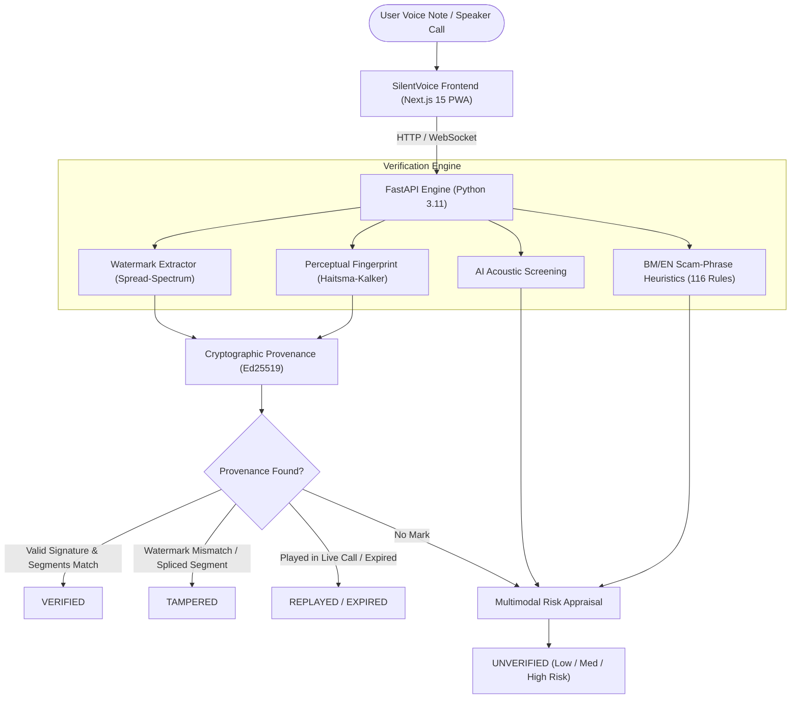

# 🛡️ SilentVoice

<p align="center">
  <strong>Jangan percaya suara. Sahkan asalnya.</strong><br>
  <em>Don't trust the voice. Verify its origin.</em>
</p>

<p align="center">
  
  
  
  
  
</p>

---

## 📸 App Preview

<p align="center">
  
  
</p>

<p align="center">
  
  
</p>

---

## 💡 Overview

**SilentVoice** is a mobile-first, bilingual (Bahasa Melayu & English) anti-fraud application built to protect everyday Malaysians from AI-generated voice cloning scams, phone impersonation, and urgent money transfer fraud.

It operates under a strict, mathematically enforced security principle:

| Capability | Method | Guaranteed Verdicts |
| :--- | :--- | :--- |
| **Verify what is authentic** | Cryptographic provenance (non-extractable **Ed25519** signatures over perceptual sub-band fingerprints) | `VERIFIED` · `TAMPERED` · `REPLAYED` · `EXPIRED` |
| **Warn about suspected fakes** | Acoustic AI voice screening + 116 curated BM/EN scam-phrase rules | Risk score only (`LOW`, `MEDIUM`, `HIGH`) — **never** `VERIFIED` |

> ⚠️ **Core Security Law:** *Only cryptographic verification can grant trust and return `VERIFIED`.* AI detection can flag suspicious patterns, but heuristic detection is never permitted to issue a `VERIFIED` status in code (`api/app/service.py`).

---

## ✨ Key Features

- **🔍 Semak Audio (Verify Voice Notes):** Pick any audio file (`.opus`, `.ogg`, `.mp3`, `.wav`) directly from WhatsApp or record live playback. Get an immediate, high-contrast verdict with actionable next steps.
- **📞 Imbas Panggilan (Live Call Scan):** Put incoming phone calls on speakerphone. SilentVoice monitors the audio stream in real-time using rolling 4 s windows and vibrates if high scam urgency or AI patterns are detected.
- **✍️ Tandatangan Suara (Sign My Voice):** Generate a non-extractable Ed25519 key pair in the browser via WebCrypto. Sign outgoing voice notes up to 60 seconds with an embedded watermark and perceptual hash before sending on WhatsApp.
- **🌓 Dark & Light Mode:** Seamlessly switch between dark and light themes with instant persistence and system-mode detection.
- **🌐 Bilingual Toggle:** Instant one-tap switching between **Bahasa Melayu** and **English** with accessible 18 px base typography designed for elderly family members.
- **🔒 Privacy by Design:** Audio is processed purely in volatile memory and never retained on disk. Phone numbers in scam reports are one-way hashed with SHA-256 and salt/pepper before logging.

---

## 🏛️ System Architecture



### Why Perceptual Hashing instead of SHA-256?
Messaging platforms like WhatsApp re-encode audio to Opus before transmission. A standard SHA-256 hash would fail on every genuine forwarded clip. SilentVoice calculates **Haitsma–Kalker perceptual fingerprints** across 33 log-spaced frequency bands (300–3400 Hz). The double difference of band energy cancels gain shifts (±6 dB) and lossy compression while detecting audio splices and replacements.

---

## 🚀 Quickstart

### Prerequisites
- Python 3.10+
- Node.js 18+ and npm

### 1. Setup Backend (FastAPI)
```bash
cd api
python3 -m venv .venv
source .venv/bin/activate    # On Windows: .venv\Scripts\activate
pip install -r requirements.txt -r requirements-dev.txt
```

### 2. Setup Frontend (Next.js PWA)
```bash
cd web
npm install
```

### 3. Run Locally
You can run both services together using the provided script:

**macOS / Linux:**
```bash
./dev.sh
```

**Windows (PowerShell):**
```powershell
./dev.ps1
```

Or manually in separate terminals:
```bash
# Terminal 1: Backend
cd api && .venv/bin/python -m uvicorn app.main:app --host 0.0.0.0 --port 8000 --reload

# Terminal 2: Frontend
cd web && npm run dev
```

- **Frontend:** [http://localhost:3000](http://localhost:3000)
- **API Docs (Swagger UI):** [http://localhost:8000/docs](http://localhost:8000/docs)
- **Health Check:** [http://localhost:8000/health](http://localhost:8000/health)

---

## 📱 Testing on a Mobile Phone (LAN)

Microphone access (`getUserMedia`) requires a **secure context** (HTTPS or localhost). To demo on a real phone over Wi-Fi:

1. Generate a local self-signed certificate:
   ```bash
   bash scripts/make-dev-cert.sh
   ```
2. Launch with HTTPS:
   ```bash
   ./dev.ps1 -Https
   ```
3. On your phone, visit `https://<laptop-ip>:8000/health` first to accept the local certificate, then visit `https://<laptop-ip>:3000`.

---

## 📊 Benchmark & Evaluation Results

Tested against real simulated channel degradation using synthetic Malay/English speech (`eval/run_eval.py`):

| Evaluation Metric | Benchmark Target | SilentVoice Result |
| :--- | :---: | :---: |
| Signed clip **VERIFIED** after WhatsApp / Opus re-encode | ≥ 95% | **100%** |
| Unsigned audio wrongly classified as **VERIFIED** | 0% | **0.0%** |
| Spliced / replaced segments identified as **TAMPERED** | ≥ 90% | **100%** |
| Replayed signed clip flagged as **REPLAYED** in Live Scan | ≥ 90% | **100%** |
| BM & English scam phrase detection recall | ≥ 80% | **100%** |
| Normal conversational false alarms | 0 | **0** |
| Average verification latency (median / p95) | ≤ 5 s | **99 ms / 171 ms** |

---

## 🧪 Running Automated Tests

Run the full end-to-end test suite (22 unit & integration tests covering signature verification, replay attacks, key revocation, tamper detection, and codec tolerance):

```bash
cd api
.venv/bin/python -m pytest tests -v
```

---

## 📄 Privacy & Legal Notice

SilentVoice is engineered around privacy-preserving principles:
- **Zero Audio Storage:** Raw audio buffers are held in temporary memory during processing and discarded immediately. No database holds audio recordings or phone conversation transcripts.
- **Screening Disclaimer:** AI voice and phrase heuristics provide early-warning risk screening to assist consumers in identifying red flags. They do not constitute formal legal evidence.

---

## 📜 License

Distributed under the MIT License. See [`LICENSE`](LICENSE) for details.
