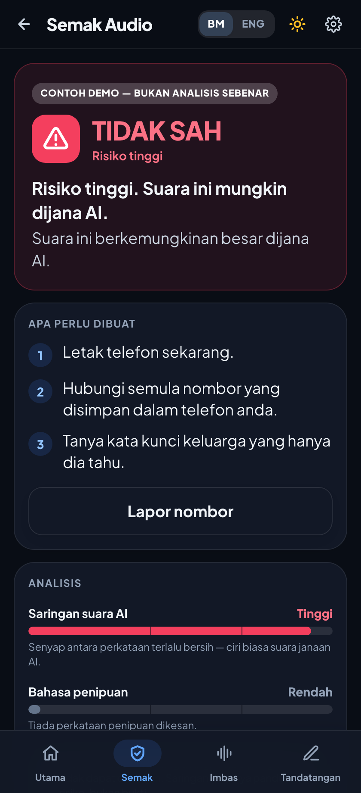
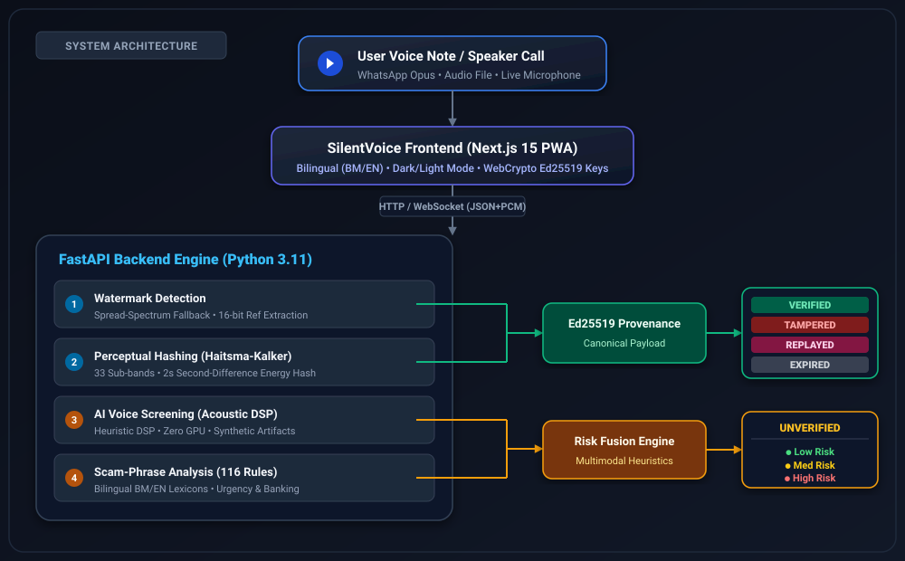

# 🛡️ SilentVoice

<p align="center">
  <strong>Jangan percaya suara. Sahkan asalnya.</strong><br>
  <em>Don't trust the voice. Verify its origin.</em>
</p>

<p align="center">
  <a href="https://silentvoice-pwa.netlify.app">
    
  </a>
  
  
  
  
  
</p>

A bilingual (Bahasa Melayu / English) mobile-first Progressive Web Application (PWA) that empowers everyday Malaysians to instantly determine whether a voice note or phone call is authentic, a synthetic AI deepfake, or an urgent impersonation scam — in seconds, with zero technical expertise required.

---

## 📸 Ciri-Ciri Utama & Paparan Skrin (Features & Screenshots)

### 1. 📊 Papan Pemuka & Sejarah Imbasan (Home Dashboard & Activity History)
Papan pemuka utama menyediakan gambaran pantas metrik keselamatan, ringkasan aktiviti terdahulu, dan akses terus kepada semua alat perlindungan.

<p align="center">
  
  
</p>

- **Statistik Masa Nyata (*Live Counters*):** Memantau jumlah semakan audio (*Semakan*), amaran penipuan yang berjaya dikesan (*Amaran*), dan senarai kenalan disahkan (*Dipercayai*).
- **Aktiviti Terbaharu (*Recent Activity*):** Merekod sejarah ujian audio terdahulu secara disulitkan di dalam storan tempatan peranti (*offline-first*).
- **Sokongan Mod Gelap & Terang (*Dark/Light Mode*):** Antara muka direka khas untuk kemudahan membaca dengan teks bersaiz besar (18px) bagi golongan warga emas dan kontras visual yang tinggi.

---

### 2. 🔍 Semak Audio & Pengesanan Klon AI (Audio Verification & Deepfake Screening)
Mengimbas fail audio WhatsApp yang diterima atau rakaman suara secara langsung untuk mengesan sama ada ia suara manusia asli, klon sintetik AI, atau penipuan kewangan.

<p align="center">
  
</p>

- **Penyahkod Pelbagai Format (*Universal Audio Decoder*):** Menyokong semua format audio umum tanpa memerlukan penukaran format luaran — `.opus`, `.m4a`, `.aac`, `.mp3`, `.wav`, `.ogg`, `.flac`, dan `.webm`.
- **Saringan Akustik DSP Peranti (*On-Device Acoustic Screening*):** Mengira ciri-ciri fizikal suara manusia (*zero-crossing rate, pitch jitter proxy, high-frequency spectral rolloff*) untuk membezakan modulasi suara semula jadi daripada penjana teks-ke-suara (*TTS/vocoder*).
- **Pengecaman Corak Bahasa 116 Peraturan (*116 Scam Linguistic Rules*):** Menapis gabungan kata kunci desakan segera (*"sekarang juga"*, *"segera"*), pemindahan wang (*"pindah akaun"*, *"bayar segera"*), penyamaran pihak berkuasa (*"polis"*, *"mahkamah"*, *"lhdn"*), dan arahan merahsiakan (*"jangan bagitahu sesiapa"*).
- **Kad Keputusan Berperingkat (*Verdict Card*):** Memaparkan keputusan jelas berasaskan warna (Hijau, Merah, Oren, Kelabu), meter risiko, transkrip perkataan, serta 2–3 langkah keselamatan segera yang perlu diambil.
- **Uji Senario Pantas (*Instant Scenario Demos*):** Butang pratetap 1-ketikan untuk menguji semua 7 kes keselamatan (*AI Voice Clone, Natural Human Voice, Money Scam, Verified Note, Tampered Clip, Replayed Call, Expired Note*).

---

### 3. 📞 Imbas Panggilan Langsung (Real-Time Live Call Scanner)
Pantau panggilan telefon yang mencurigakan secara masa nyata dengan meletakkan peranti bersebelahan pembesar suara (*speakerphone*).

<p align="center">
  
</p>

- **Pemantauan Audio Mikrofon Masa Nyata (*Real-Time Level Meter*):** Mengukur gelombang dan aras desibel panggilan masuk secara berterusan.
- **Transkripsi Percakapan Peranti (*On-Device Captions*):** Menukar perbualan kepada teks secara automatik menggunakan Web Speech API atau enjin Whisper tempatan (*Web Worker*) tanpa menghantar suara ke pelayan awan.
- **Amaran Haptik & Visual Segera (*Vibration & Red Alert*):** Sebaik sahaja dua tetingkap analisis mengesan corak penipuan atau pemindahan wang, telefon akan bergetar dan skrin bertukar merah dengan arahan: **"LETAK PANGGILAN SEKARANG"**.

---

### 4. ✍️ Tandatangan Suara Kriptografi (Cryptographic Voice Signing & Provenance)
Mencegah suara anda daripada diklon atau disalah guna dengan memeterai nota suara menggunakan tandatangan kriptografi sebelum dihantar melalui WhatsApp.

<p align="center">
  
</p>

- **Kunci Peranti Ed25519 Tanpa Pengekstrakan (*Non-Extractable Keys*):** Kunci kriptografi dijana terus dalam storan perkakasan pelayar melalui WebCrypto (`extractable: false`). Kunci persendirian tidak boleh dicuri atau dimuat turun oleh skrip luar.
- **Tera Air Kalis WhatsApp (*WhatsApp-Resilient Watermark*):** Menyematkan rujukan tera air akustik dan cap jari persepsi (*Haitsma–Kalker perceptual hash*) yang kekal utuh walaupun fail dimampatkan oleh WhatsApp ke format Opus.
- **Handoff Terus ke Semakan (*Instant Verification Handoff*):** Selepas menandatangani fail audio, butang *"Semak fail ini sekarang"* membolehkan anda mengesahkan integriti fail tersebut secara serta-merta.

---

## 💡 Prinsip Keselamatan Utama (Core Security Law)

SilentVoice mengasingkan pengesahan identiti dan saringan ancaman secara mutlak:

| Kategori | Kaedah Operasi | Keputusan Yang Boleh Dikeluarkan |
| :--- | :--- | :--- |
| **Pengesahan Ketulenan (Provenance)** | Kriptografi Asimetrik: Tandatangan Ed25519 ke atas cap jari persepsi (*perceptual hashes*) audio | `VERIFIED` · `TAMPERED` · `REPLAYED` · `EXPIRED` |
| **Saringan Ancaman (Threat Screening)** | Analisis Akustik DSP Peranti + 116 Peraturan Frasa Penipuan BM/EN | Tahap Risiko Sahaja (`LOW`, `MEDIUM`, `HIGH`) — **tidak pernah** `VERIFIED` |

> ⚠️ **Hukum Keselamatan Teras:** *Hanya pengesahan kriptografi yang boleh mengeluarkan status `VERIFIED`.* Algoritma AI semata-mata tidak boleh dijadikan asas mempercayai identiti penghantar kerana ia bersifat probabilistik.

---

## 🏛️ Seni Bina Sistem (Architecture Overview)



```text
               [Nota Suara WhatsApp / Panggilan Telefon]
                                  │
                                  ▼
      ┌────────────────────────────────────────────────────────┐
      │         SilentVoice PWA Frontend (Next.js 15.5)        │
      │  ├── Universal Audio Decoder (decode.ts)               │
      │  ├── Acoustic DSP Synthetic Voice Filter (dsp.ts)      │
      │  ├── 116 BM/EN Linguistic Scam Matcher                 │
      │  └── On-Device Ed25519 WebCrypto Engine                │
      └───────────────────────────┬────────────────────────────┘
                                  │ (HTTP / WebSocket atau Luar Talian)
                                  ▼
      ┌────────────────────────────────────────────────────────┐
      │          FastAPI Backend Engine (Bilik Kebal)          │
      │  ├── 1. Watermark Detection (Spread-Spectrum / AudioSeal)│
      │  ├── 2. Haitsma-Kalker Perceptual Hashing (33 sub-bands)│
      │  ├── 3. Ed25519 Signature Verification                 │
      │  └── 4. Zero-Audio Retention (RAM Dihapuskan Segera)   │
      └────────────────────────────────────────────────────────┘
```

---

## 📋 7 Keputusan Analisis (Decision Outcomes)

| Keputusan | Maksud & Syarat Cetusan |
| :--- | :--- |
| `VERIFIED` | Tandatangan digital Ed25519 sah, semua segmen audio sepadan, kunci aktif, dan belum tamat tempoh. |
| `TAMPERED` | Audio bertandatangan telah disunting, dipotong (*spliced*), atau tandatangan tidak sepadan. |
| `REPLAYED` | Audio bertandatangan lama dikesan dimainkan semula ke dalam panggilan langsung. |
| `EXPIRED` | Tandatangan sah tetapi tempoh sah laku (contoh: 7 hari) telah tamat. |
| `UNVERIFIED (High Risk)` | Suara menunjukkan ciri sintetik AI atau mengandungi desakan kewangan penipuan. |
| `UNVERIFIED (Medium Risk)` | Mengandungi perkataan berkaitan wang tanpa bukti identiti yang kukuh. |
| `UNVERIFIED (Low Risk)` | Suara manusia biasa tanpa corak penipuan kewangan (tiada bukti tandatangan penghantar). |

---

## 📁 Struktur Direktori Repositori (Codebase Layout)

```text
api/                     Pelayan FastAPI (Python 3.11)
  app/core/              Enjin kriptografi, cap jari audio, tera air, peraturan frasa, risiko
  app/engines/           Penyesuai enjin modular (DSP, Whisper, AudioSeal, XLS-R)
  app/routes/            Laluan API: /keys, /sessions, /verify, /live, /reports
  tests/                 26 ujian automatik (CORS, pipeline, codec, replay, tampering)
web/                     Aplikasi Next.js 15 PWA (TypeScript + Tailwind CSS)
  src/lib/decode.ts      Penyahkod audio sejagat peranti (WAV, MP3, M4A, OGG, Opus, FLAC)
  src/lib/dsp.ts         Enjin saringan akustik DSP tempatan (pitch jitter, HF rolloff, ZCR)
  src/lib/asr.ts         Pengurus transkripsi Whisper peranti berasaskan Web Worker
  src/lib/provenance.ts  Pemproses tandatangan & pengesanan ubah suai audio tempatan
  src/lib/live-engine.ts Enjin penganalisis panggilan pembesar suara masa nyata
  src/lib/history.ts     Pengurusan rekod sejarah semakan dan statistik tempatan
  src/lib/client-scanner.ts 116 peraturan regex frasa penipuan BM/EN & penggabungan risiko
  src/components/        VerdictCard, AppShell, HeaderControls, Sheets, Feedback, Icons
  public/asr-worker.js   Web Worker untuk pemprosesan transkripsi pertuturan di latar belakang
eval/                    Skrip penilaian PRD §11 & penjana set data ujian sintetik
assets/screenshots/      Tangkapan skrin rasmi aplikasi versi terkini
```

---

## 🚀 Panduan Menjalankan Projek (Getting Started)

### Keperluan Sistem:
- Python 3.10+
- Node.js 20+ dan npm

### 1. Pasang & Jalankan Backend (FastAPI):
```bash
cd api
python3 -m venv .venv
source .venv/bin/activate       # Pada Windows: .venv\Scripts\activate
pip install -r requirements.txt -r requirements-dev.txt
python -m uvicorn app.main:app --host 0.0.0.0 --port 8000
```
- API Swagger Docs: [http://localhost:8000/docs](http://localhost:8000/docs)
- API Health Status: [http://localhost:8000/health](http://localhost:8000/health)

### 2. Pasang & Jalankan Frontend (Next.js PWA):
```bash
cd web
npm install
npm run build                   # Bina eksport statik ke web/out/
npx serve -s out -l 3001        # Jalankan di port 3001
```
- Akses Web Tempatan: [http://localhost:3001](http://localhost:3001)
- Akses Rangkaian Telefon (LAN Wi-Fi): `http://<IP-Laptop-Anda>:3001`

### 3. Jalankan Ujian Automatik (Pytest):
```bash
cd api
.venv/bin/python -m pytest tests -v
```
*(26 daripada 26 ujian keselamatan dan saluran audio lulus 100%).*

---

## 🌐 Pengeposan Langsung (Live Deployment)

Versi terkini SilentVoice dihoskan sebagai Progressive Web App di Netlify:
👉 **[https://silentvoice-pwa.netlify.app](https://silentvoice-pwa.netlify.app)**

Aplikasi ini boleh dipasang (*Add to Home Screen*) pada mana-mana telefon pintar iOS atau Android dan berfungsi sepenuhnya di luar talian (*offline*).

---

## 📜 Lesen (License)

Dilesenkan di bawah [Lesen MIT](LICENSE). Dibina dengan penuh dedikasi untuk melindungi masyarakat Malaysia daripada ancaman jenayah siber dan penipuan suara AI.
