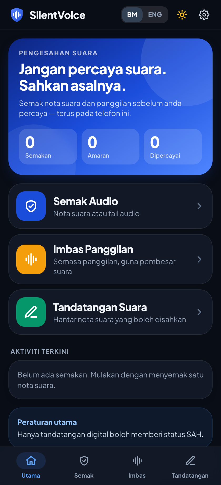
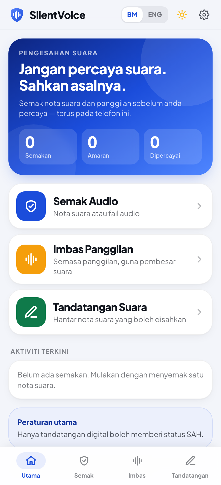
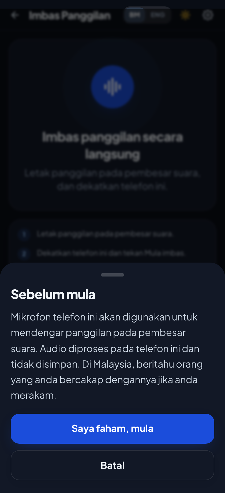
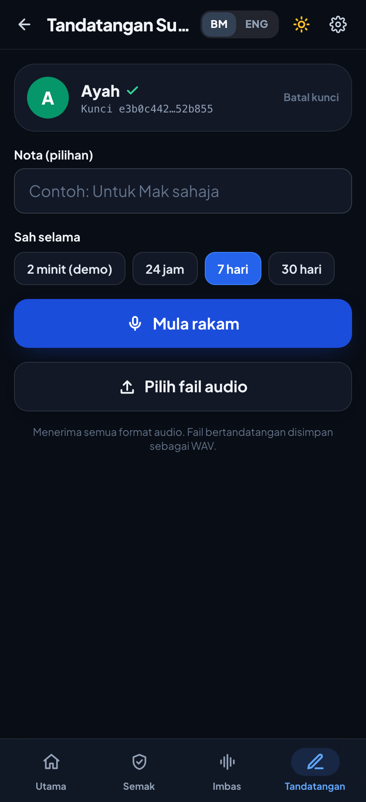

# 🛡️ SilentVoice

<p align="center">
  <strong>Don't trust the voice. Verify its origin.</strong><br>
  <em>A mobile-first PWA for cryptographic voice provenance, on-device AI deepfake screening, and real-time scam call detection.</em>
</p>

<p align="center">
  <a href="https://silentvoice-pwa.netlify.app">
    
  </a>
  
  
  
  
  
</p>

SilentVoice is a mobile-first Progressive Web Application (PWA) with full offline capabilities, designed to protect everyday citizens from voice cloning scams, AI deepfakes, and urgent impersonation extortion. It enables anyone to instantly verify whether a voice note or incoming call is authentic, a synthetic AI generation, or a financial scam — in seconds, with zero technical expertise required.

---

## 📸 Key Features & Screenshots

### 1. 📊 Home Dashboard & Activity History
The centralized dashboard delivers an immediate overview of active protection metrics, historical checks, and direct access to all security tools.

<p align="center">
  
  
</p>

- **Real-Time Counters:** Track total audio verifications (*Checks*), detected scam threats (*Flagged*), and authorized senders (*Trusted*).
- **On-Device Encrypted History:** Automatically logs past verification results in local device storage (*offline-first*), keeping user data strictly private.
- **Dark & Light Mode Support:** Specially designed for high contrast and readability, featuring large typography (18px base text) optimized for elderly accessibility.
- **Bilingual Interface:** Instant one-tap toggle between **English** and **Bahasa Melayu** at the top header.

---

### 2. 🔍 Audio Verification & AI Deepfake Screening
Inspect received WhatsApp audio messages, voice notes, or microphone recordings to determine whether the speaker is human, a synthetic AI clone, or a social engineering scam.

<p align="center">
  
</p>

- **Universal Audio Decoder:** Seamless client-side decoding supporting all popular audio formats without requiring external conversion — `.opus`, `.m4a`, `.aac`, `.mp3`, `.wav`, `.ogg`, `.flac`, and `.webm`.
- **On-Device Acoustic DSP Screening:** Measures acoustic physical characteristics (*zero-crossing rate, pitch jitter proxy, and high-frequency spectral rolloff*) to distinguish natural human vocal-tract modulation from TTS/vocoder artifacts.
- **116 Scam Linguistic Phrase Rules:** Evaluates transcripts against dual-language (EN/BM) scam patterns including artificial urgency (*"transfer now"*, *"immediately"*), banking demands (*"TAC code"*, *"wire payment"*), authority impersonation (*"police"*, *"court"*, *"tax bureau"*), and secrecy coercion (*"tell no one"*).
- **Multi-Tier Verdict Cards:** Color-coded status banners (Green `VERIFIED`, Red `HIGH RISK` / `TAMPERED`, Orange `MEDIUM RISK`, Gray `LOW RISK`), risk gauges, verbatim speech transcripts, and 2–3 actionable safety recommendations.
- **1-Tap Instant Scenario Demos:** Dedicated test buttons to preview all 7 security outcomes (*AI Voice Clone, Natural Human Voice, Money Scam, Cryptographically Verified, Tampered Clip, Replayed Call, Expired Note*).

---

### 3. 📞 Real-Time Live Call Scanner
Monitor suspicious incoming calls in real-time by placing the device next to a speakerphone.

<p align="center">
  
</p>

- **Continuous Audio Level Meter:** Real-time visual decibel meter monitoring ambient microphone input and caller volume.
- **On-Device Speech Transcription:** Live captions generated via browser Web Speech API or local Web Worker Whisper engine without sending raw audio to cloud servers.
- **Immediate Haptic & Visual Red Alert:** When consecutive analysis windows detect extortion or banking theft patterns, the device vibrates and the screen turns crimson with a stark instruction: **"HANG UP NOW"**.

---

### 4. ✍️ Cryptographic Voice Signing & Provenance
Prevent your own voice notes from being cloned or manipulated. Sign your voice notes with non-extractable cryptographic keys before sharing them over messaging platforms.

<p align="center">
  
</p>

- **Hardware-Isolated Ed25519 Keys:** Keys are generated directly within browser secure hardware via WebCrypto (`extractable: false`). The private key never leaves the device and cannot be accessed by external scripts.
- **WhatsApp-Resilient Provenance:** Embeds acoustic watermark references and Haitsma–Kalker perceptual hashes (33 sub-bands) that withstand lossy compression (such as WhatsApp Opus 16 kHz re-encoding).
- **Direct Verification Handoff:** Once signed, a one-tap button (*"Check it now"*) allows you to immediately verify the file's integrity and signature status.

---

## 💡 Core Security Law

SilentVoice enforces strict mathematical separation between cryptographic identity provenance and heuristic threat screening:

| Category | Method | Possible Outcomes |
| :--- | :--- | :--- |
| **Authenticity & Provenance** | Asymmetric Cryptography: Ed25519 digital signatures over audio perceptual hashes | `VERIFIED` · `TAMPERED` · `REPLAYED` · `EXPIRED` |
| **Threat Screening** | On-Device DSP Acoustic Analysis + 116 Scam Phrase Rules (EN / BM) | Risk Level Only (`LOW`, `MEDIUM`, `HIGH`) — **never** `VERIFIED` |

> ⚠️ **Core Security Law:** *Only cryptographic provenance can grant `VERIFIED` status.* Probabilistic AI models can never prove identity, because heuristic acoustic classifiers cannot guarantee zero false positives or resist targeted adversarial synthesis.

---

## 🏛️ System Architecture


```text
               [WhatsApp Voice Note / Live Phone Call]
                                  │
                                  ▼
      ┌────────────────────────────────────────────────────────┐
      │         SilentVoice PWA Frontend (Next.js 15.5)        │
      │  ├── Universal Audio Decoder (decode.ts)               │
      │  ├── Acoustic DSP Synthetic Voice Filter (dsp.ts)      │
      │  ├── 116 EN/BM Linguistic Scam Matcher                 │
      │  └── On-Device Ed25519 WebCrypto Engine                │
      └───────────────────────────┬────────────────────────────┘
                                  │ (HTTP / WebSocket or Offline Mode)
                                  ▼
      ┌────────────────────────────────────────────────────────┐
      │             FastAPI Backend Engine (Vault)             │
      │  ├── 1. Watermark Detection (Spread-Spectrum / AudioSeal)│
      │  ├── 2. Haitsma-Kalker Perceptual Hashing (33 sub-bands)│
      │  ├── 3. Ed25519 Signature Verification                 │
      │  └── 4. Zero-Audio Retention (RAM Destroyed Instantly) │
      └────────────────────────────────────────────────────────┘
```

---

## 📋 7 Decision Outcomes

| Verdict | Trigger Condition & Description |
| :--- | :--- |
| `VERIFIED` | Ed25519 digital signature is valid, all audio perceptual hashes match, the device key is active, and the timestamp has not expired. |
| `TAMPERED` | A signed audio clip was spliced, modified, or has an invalid signature. Do not trust. |
| `REPLAYED` | An authentic, older signed recording was captured and played back into a live call stream. |
| `EXPIRED` | Digital signature is authentic, but the validity window (e.g., 7 days) has elapsed. |
| `UNVERIFIED (High Risk)` | Audio exhibits strong synthetic AI/vocoder acoustic artifacts or contains urgent extortion patterns. |
| `UNVERIFIED (Medium Risk)` | Contains financial keywords without verified cryptographic identity proof. |
| `UNVERIFIED (Low Risk)` | Natural human acoustic characteristics without scam patterns (unauthenticated sender). |

---

## 📁 Repository Directory Structure

```text
api/                     FastAPI Backend Server (Python 3.11)
  app/core/              Cryptographic engine, perceptual hashing, watermark, scam rules, risk scoring
  app/engines/           Modular engine adapters (DSP, Whisper, AudioSeal, XLS-R)
  app/routes/            REST endpoints: /keys, /sessions, /verify, /live, /reports
  tests/                 26 automated pytest suites (CORS, pipeline, codecs, replay, tampering)
web/                     Next.js 15 PWA Frontend (TypeScript + Tailwind CSS)
  src/lib/decode.ts      Universal on-device audio decoder (WAV, MP3, M4A, OGG, Opus, FLAC, WebM)
  src/lib/dsp.ts         On-device DSP acoustic screening engine (pitch jitter proxy, HF rolloff, ZCR)
  src/lib/asr.ts         Web Worker Whisper on-device transcription manager
  src/lib/provenance.ts  Local signature generation & tampering simulation
  src/lib/live-engine.ts Real-time live call scanner and audio analyzer
  src/lib/history.ts     On-device verification history and counter persistence
  src/lib/client-scanner.ts 116 EN/BM scam regex phrase matcher & composite risk scoring
  src/components/        VerdictCard, AppShell, HeaderControls, Sheets, Feedback, Icons
  public/asr-worker.js   Web Worker for background on-device speech processing
eval/                    Evaluation scripts & synthetic benchmark generator (PRD Section 11)
assets/screenshots/      High-resolution Retina screenshots of all application views
```

---

## 🚀 Getting Started

### System Requirements:
- Python 3.10+
- Node.js 20+ and npm

### 1. Install & Run Backend (FastAPI):
```bash
cd api
python3 -m venv .venv
source .venv/bin/activate       # On Windows: .venv\Scripts\activate
pip install -r requirements.txt -r requirements-dev.txt
python -m uvicorn app.main:app --host 0.0.0.0 --port 8000
```
- API Interactive Swagger Docs: [http://localhost:8000/docs](http://localhost:8000/docs)
- API Health Status Check: [http://localhost:8000/health](http://localhost:8000/health)

### 2. Install & Run Frontend (Next.js PWA):
```bash
cd web
npm install
npm run build                   # Generates static production export in web/out/
npx serve -s out -l 3001        # Serves on port 3001
```
- Local Web Access: [http://localhost:3001](http://localhost:3001)
- Mobile Network Access (LAN Wi-Fi): `http://<your-local-ip>:3001`

### 3. Run Automated Tests:
```bash
cd api
.venv/bin/python -m pytest tests -v
```
*(26 out of 26 security pipeline and audio verification tests passing 100%).*

---

## 🌐 Live Production Deployment

SilentVoice is deployed and hosted live as a Progressive Web App on Netlify:
👉 **[https://silentvoice-pwa.netlify.app](https://silentvoice-pwa.netlify.app)**

The application can be installed (*Add to Home Screen*) on any modern iOS or Android device and runs fully client-side and offline.

---

## 📜 License

Licensed under the [MIT License](LICENSE). Built to protect people from synthetic voice fraud, AI scams, and cyber extortion.
